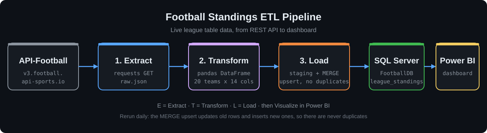
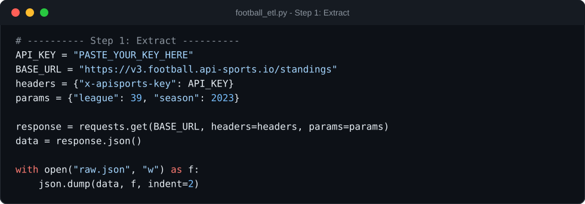
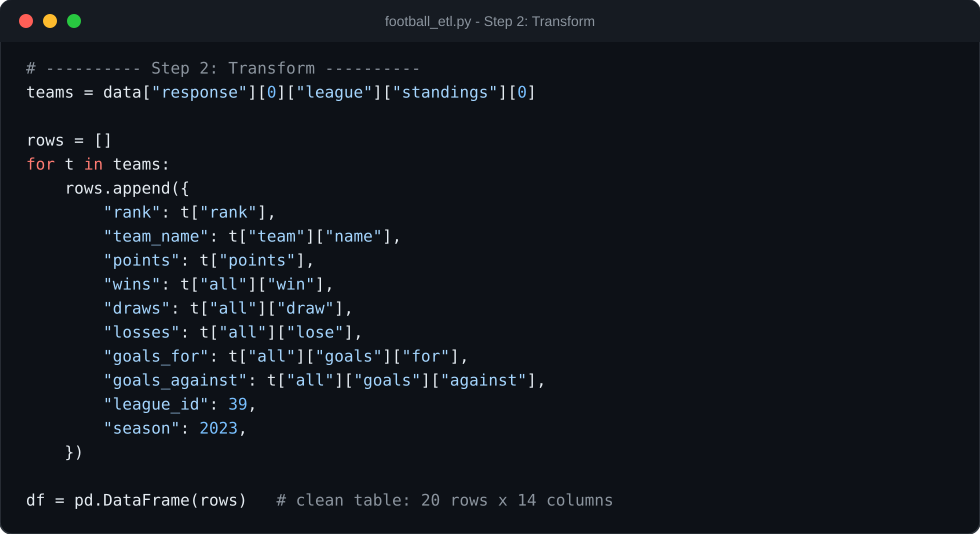
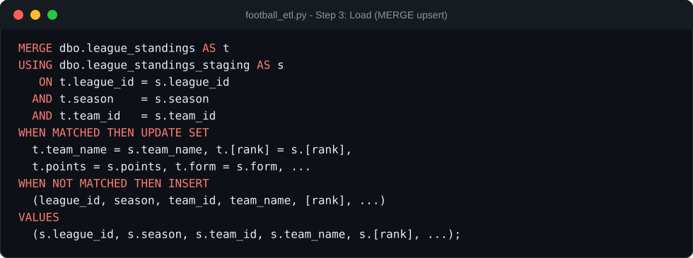

# Football Standings ETL Pipeline

An end-to-end ETL pipeline: it collects live Premier League table data from the API-Football REST API, cleans it with pandas, stores it in SQL Server, and feeds a two-page Power BI dashboard. A staging table and a MERGE upsert mean you can rerun it daily with no duplicate rows.

**Flow:** API-Football (REST) → Python (requests, pandas) → SQL Server (SQLAlchemy) → Power BI

[Pipeline](#pipeline) · [ETL steps](#the-three-etl-steps) · [Dashboard](#dashboard) · [How to run](#how-to-run) · [Troubleshooting](#troubleshooting)

## What this project does

The goal is to collect live football league table data from the internet, clean it, store it in a database, and show it in charts. That whole journey is called an ETL pipeline.

| Letter | Word | Plain meaning | In this project |
| --- | --- | --- | --- |
| E | Extract | Get the data from its source | Ask the API for the league table and save the answer as `raw.json` |
| T | Transform | Clean and reshape the data | Pick out the team rows and turn them into a pandas table |
| L | Load | Store the data somewhere useful | Put the table into SQL Server using SQLAlchemy |

After ETL comes **Visualize**: Power BI reads the SQL Server table and draws the charts.

## Pipeline

## Tools and why

| Tool | Why we use it |
| --- | --- |
| Python | The language that runs all the steps |
| requests | Talks to the API over the internet |
| json | Saves and reads the raw API reply |
| pandas | Works with tables (DataFrames) in Python |
| SQLAlchemy + pyodbc | Connect Python to SQL Server |
| SQL Server + SSMS | The database, and the tool used to look at it |
| Power BI | Turns the database table into charts and dashboards |

## The three ETL steps

### 1. Extract: ask the API and keep the raw answer

A GET request to the standings endpoint (league `39` is the Premier League, season `2023`). The full reply is saved as `raw.json`, so the data can be reprocessed without calling the API again.

**Success check:** status `200`, empty errors, and a `raw.json` file in the project folder.

### 2. Transform: from nested JSON to a clean table

The API reply is nested, like boxes inside boxes. A loop opens the right box for each team and builds a clean DataFrame of 20 teams and 14 columns: rank, points, wins, draws, losses, goals for/against, goal difference and form. The loop reads each value directly, so it does not break when the nested names are not what you expect.

### 3. Load: staging table and MERGE upsert

SQLAlchemy connects to SQL Server and creates `dbo.league_standings` if it does not exist yet (primary key: league + season + team, so the same team can never appear twice for one season). The DataFrame lands in a temporary staging table, then a T-SQL `MERGE` updates the teams that already exist and inserts the new ones. The staging table is dropped right after.

This is why the script can run every day: old rows are refreshed and no duplicates are created. A final check counts the rows; it should print `20`.

## Dashboard

The Power BI dashboard `ETL_EPL_2024.pbix` (2 pages) reads the SQL Server table and covers position, points, wins, draws and losses, home and away wins, goals scored and conceded, goal difference, goals per match and form.

To refresh it later: run the Python script again, then click **Refresh** in Power BI.

## How to run

1. `pip install -r requirements.txt`
2. In SSMS, run `CREATE DATABASE FootballDB;` once. Check your driver name with `import pyodbc; print(pyodbc.drivers())`.
3. In `football_etl.py`, replace `PASTE_YOUR_KEY_HERE` with your API-Football key, and set `SERVER` and `DRIVER` for your machine. Leave `SQL_USER` blank to use Windows Authentication.
4. `python football_etl.py`. You should see status `200`, empty errors, `Connected! Test result: 1` and `Rows in table: 20`.
5. Open `ETL_EPL_2024.pbix` in Power BI Desktop, or build your own: Get data → SQL Server → your server + `FootballDB` → Import → tick `league_standings` → Load.

## Troubleshooting

| Error | Fix |
| --- | --- |
| `KeyError: 'team.id'` | Read nested values with a loop, as in the script |
| Named Pipes / could not open a connection | Copy the exact server name from SSMS and start the SQL Server service in `services.msc` |
| Cannot open database FootballDB | Run `CREATE DATABASE FootballDB;` in SSMS |
| Data source name not found | Copy the driver name exactly from `pyodbc.drivers()` |
| Login failed | Leave `SQL_USER` blank to use Windows Authentication |
| Empty response or IndexError | Check `data["errors"]`; try season `2022` |

## Project files

- `football_etl.py`: the full pipeline (extract, transform, load)
- `requirements.txt`: the libraries to install
- `ETL_EPL_2024.pbix`: the Power BI dashboard
- `docs/images/`: the diagrams used in this README

## Notes

- **Security:** never commit a real API key. Keep `PASTE_YOUR_KEY_HERE` in the shared code and paste your key only in your local copy.
- **Future improvements:** load several leagues and seasons at once, schedule the script to run daily, add more data such as top scorers and fixtures, and move the API key into an environment variable.
